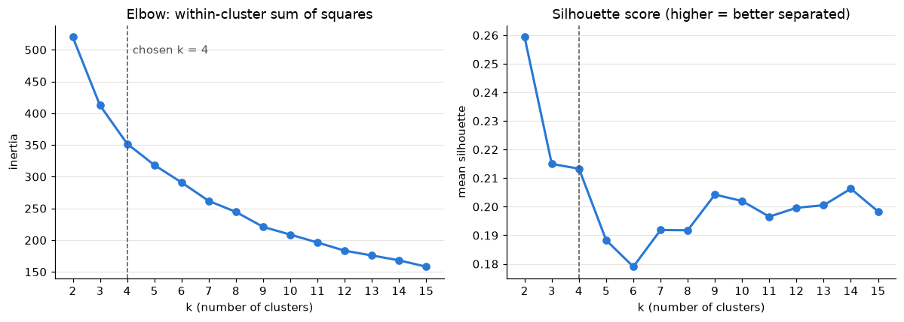
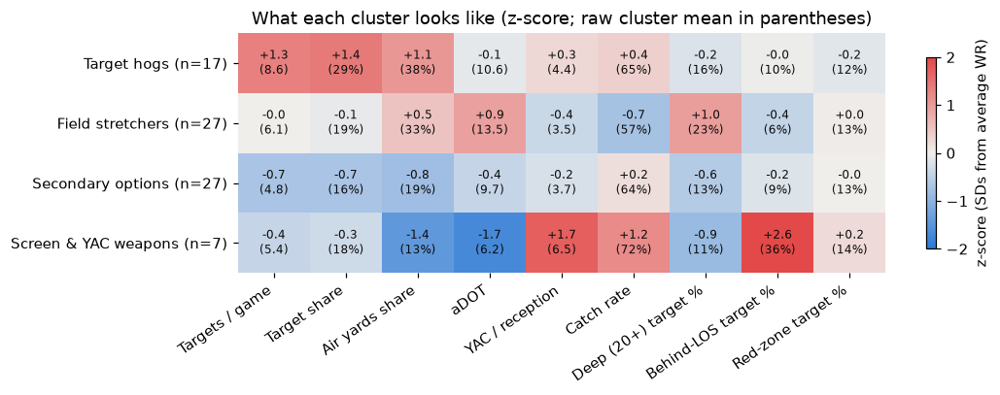
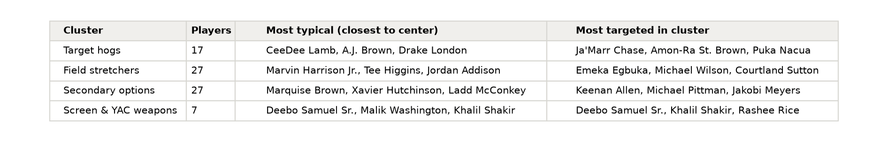
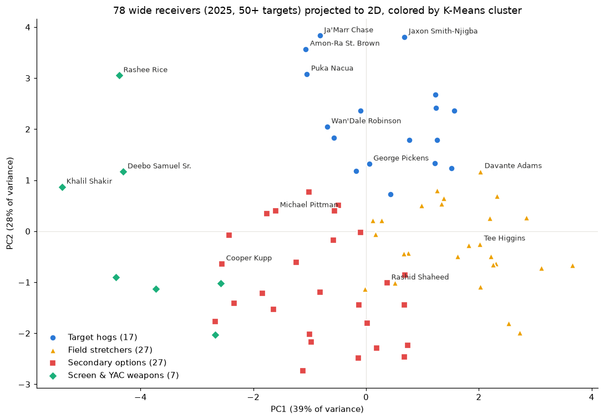
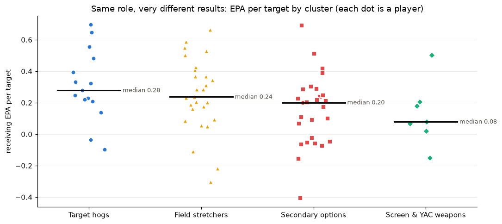

# Four Kinds of NFL Wide Receiver: Clustering the 2025 Season by How Players Are Used

*INST414 Module 3. Code and data: [GITHUB REPO URL PLACEHOLDER: https://github.com/johnpluto2k/nfl-player-clusters]*

## The question

Receivers usually get compared by box score: yards, touchdowns, catch rate. But two receivers with the same yards can have totally different jobs. One catches screens and runs after the catch, another runs go routes and catches half of what's thrown to him.

**Question:** If you group NFL wide receivers by *how they are used* instead of how productive they were, what role archetypes show up, and how much value does each role produce per target?

**Stakeholder and decision:** An NFL pro-personnel (pro scouting) staff that keeps a board of receivers the team could trade for or sign. The clusters inform two decisions: (1) when the team needs to replace a specific role, which receivers are real role substitutes, and (2) how much to trust "efficiency" stats like catch rate and yards after catch (YAC) when comparing players across roles.

**The non-obvious part:** the cluster with the *best* catch rate (72%) and the most YAC (6.5 per catch) produced the *least* value per target, 0.13 expected points added (EPA) per target. The cluster with the *worst* catch rate (57%) produced the second most, 0.24. Catch rate and YAC mostly describe a receiver's role, so a scout should compare a receiver to others in the same cluster.

## The data

Everything is from the 2025 NFL regular season, in three files:

- **Season player stats:** games, targets, receptions, yards, touchdowns, air yards, YAC and receiving EPA for each player. These give volume and efficiency.
- **Weekly player stats:** which games each player played, and for which team, so shares can be computed fairly.
- **Play-by-play:** for every pass, the intended receiver, how far downfield it was thrown (air yards) and where on the field. From this I counted each receiver's deep targets (20+ air yards), targets at or behind the line of scrimmage (screens) and red-zone targets. These splits basically describe a receiver's job.

**Volume filter:** I only clustered WRs with **at least 50 targets** (about three a game), since rates like catch rate are too noisy on small samples. Of the 223 WRs targeted at least once, **78 made the cut**.

## How the data was collected

The data comes from [nflverse](https://github.com/nflverse), an open-source project that publishes NFL stats and play-by-play. I downloaded the CSV files from the [nflverse-data GitHub releases](https://github.com/nflverse/nflverse-data/releases) with Python's `requests` library on October 23, 2026, saving a sha256 hash of each file. The rest used `pandas`, `scikit-learn` and `matplotlib`.

One problem came up. nflverse's season target share divides by the team's targets for the *whole season*, including games the player missed, so injured players look like minor parts of their offense. Garrett Wilson played 7 games; the file says his target share was 12.5%, but in his games it was 33.7%. So I recomputed target share and air yards share over games played only. For the 28 WRs who played all 17 games for one team, my numbers match nflverse's exactly.

## Features and similarity

Each receiver is described by 9 numbers: **targets per game**, **target share**, **air yards share** (share of the team's downfield passing yards thrown his way), **aDOT** (average depth of target), **YAC per reception**, **catch rate**, **deep target %**, **behind-the-line target %** and **red-zone target %**. Together they cover how much a receiver is used, where, and what kind of catches he makes.

I left EPA, yards per target, touchdowns and fantasy points **out** on purpose. With them in, the clusters would just split good receivers from bad ones. Without them, the groups are based on role, and I can ask afterwards how productive each role is.

Because the features are on different scales (aDOT is around 11, catch rate around 0.6), I standardized each with `StandardScaler`. Then I used **K-Means with Euclidean distance**. Euclidean fits because every feature is continuous and, after scaling, a one-standard-deviation difference counts the same on every feature. It's also what K-Means minimizes. I didn't use cosine similarity because it ignores magnitude, and volume is a real part of a role.

## Choosing k

I ran K-Means for k = 2 to 15 and recorded inertia (for the elbow), mean silhouette score, and stability across 20 random seeds (adjusted Rand index, ARI, where 1 means identical results).

*Figure 1. Inertia (left) and silhouette (right). Dashed line = k = 4.*

I chose **k = 4**:

- Inertia drops by 107.5 from k = 2 to 3 and 60.6 from 3 to 4, then only 33.5 from 4 to 5 and 27.5 from 5 to 6. The elbow is at 4.
- Silhouette is 0.259 at k = 2, 0.215 at k = 3, 0.213 at k = 4, then falls to 0.188 at k = 5. k = 2 scores best but only splits high-volume receivers from everyone else, which doesn't help a scout.
- k = 4 separates a small, very distinct screen/YAC group that k = 3 merges into the others. k = 3 is more stable across seeds (ARI 0.97 vs 0.76), so I checked k = 4's stability more carefully below.

A silhouette around 0.21 is low. Receiver roles overlap, so these clusters are summaries, not hard categories.

## What each cluster represents

*Figure 2. Cluster averages in standard deviations from the average WR (red above, blue below); raw averages in parentheses.*

*Table 1. Cluster sizes and examples. "Most typical" = closest to the cluster center.*

**1. Target hogs (17 players).** The receivers the offense runs through: 8.6 targets per game, 29% of team targets and 38% of team air yards. Their depth (aDOT 10.6) is about average, so they're defined by volume at every level, not route depth. Examples: Ja'Marr Chase, Amon-Ra St. Brown, Puka Nacua and Jaxon Smith-Njigba (the four most-targeted WRs); CeeDee Lamb and A.J. Brown are the most typical.

**2. Field stretchers (27 players).** Average volume, but the ball goes deep: the highest aDOT (13.5) and deep-target rate (23%), and the lowest catch rate (57%) and YAC (3.5). Incompletions on 25-yard throws come with the job. Examples: Marvin Harrison Jr., Tee Higgins, Courtland Sutton and Davante Adams (who also had the highest red-zone target rate of all 78, 28%, and 14 TDs).

**3. Secondary options (27 players).** The lowest volume (4.8 targets per game, 16% target share, 19% air yards share) at medium depth (aDOT 9.7): second and third options who get the ball when the coverage dictates. Examples: Keenan Allen, Michael Pittman, Jakobi Meyers and Ladd McConkey.

**4. Screen & YAC weapons (7 players).** The most distinct group. 36% of their targets are at or behind the line of scrimmage (the average WR: about 11%), aDOT is only 6.2, and they have the highest catch rate (72%) and YAC (6.5). Teams design touches for them. Examples: Deebo Samuel Sr., Khalil Shakir and Rashee Rice.

*Figure 3. The 78 receivers on the first two principal components (67% of the variance): short/YAC on the left, deep on the right, volume going up. PCA is only for this picture.*

## The insight: role decides what "efficient" looks like

Then I compared clusters on stats that were *not* used to build them. Pooling all targets in each cluster, EPA per target is **0.32 for Target hogs, 0.24 for Field stretchers, 0.16 for Secondary options and 0.13 for Screen & YAC weapons**. Yards per target follows the same order (8.7, 8.1, 7.3, 7.1), and Field stretchers have the most TDs per 100 targets (5.6).

*Figure 4. EPA per target; each dot is a player, black lines are medians.*

The Screen & YAC group has the best catch rate and YAC but the lowest EPA per target (median 0.08), while Field stretchers catch the fewest passes and are second. Ranking receivers by league-wide catch rate gets these groups backwards. For the staff, that means:

1. **Compare inside the cluster.** Alec Pierce (+0.66 EPA per target) and Jerry Jeudy (−0.30) are both Field stretchers. Jeudy's 47% catch rate is a red flag because it's low *for a field stretcher*, not because it's low for the league.
2. **Don't pay extra for catch rate and YAC alone.** A screen-heavy receiver posts great efficiency numbers by design, but unless the offense needs that role, a downfield receiver with an ugly catch rate returns more per target.

Role isn't destiny, though: player EPA per target has an SD of about 0.2 inside every cluster, about as big as the gaps between clusters.

## Validation, and how I checked the AI's work

I used an AI assistant (Claude, through Claude Code) to write the download, feature and clustering code and a first draft of this post. Since AI output can be confidently wrong, I had it write checks that actually run (`src/validate.py`). All 25 pass, and I reviewed the results and cluster lists myself.

**Input:**
- 2,020 player rows, 2025 regular season only. All 78 kept WRs have 50+ targets and every dropped WR has fewer. No missing values; all rates between 0 and 1.
- Targets counted from play-by-play equal the player-stats targets for every WR (9,590 total), and air yards match too.
- Games, catches, targets, yards and TDs for 11 players (e.g. Smith-Njigba's 1,793 yards, Nacua's 129 catches) match ESPN's 2025 stats, 55 of 55 numbers.

**Output:**
- Refitting from scratch reproduces the saved clusters exactly.
- **Stability:** 30 more runs with different seeds agree with the final model at a mean ARI of 0.82 (minimum 0.71). 67 of 78 receivers stay in the same cluster in every run, and the Screen & YAC group never changes. The main movers are seven low-volume, deeper Secondary options (e.g. Rashid Shaheed, Tre Tucker) who join the Field stretchers in 19 of 30 runs. With one random start per run, mean ARI drops to 0.62, so the final model uses 500 starts.
- Ward agglomerative clustering agrees moderately (ARI 0.63), so the broad groups aren't just a K-Means artifact, but exact boundaries depend on the method.
- **Plausibility:** the four most-targeted WRs are all Target hogs, and the names fit what I know (Deebo Samuel as a screen player, Tee Higgins as a downfield receiver).

## Limitations and bias

- **Missing data.** nflverse has no routes run or alignment (slot vs outside), so yards per route run and slot rate, probably the best role features, are missing. Tight ends and running backs are left out.
- **EPA isn't only the receiver.** It depends on the quarterback, line and play call; screens are low-EPA partly by design. Justin Jefferson landed at −0.10 EPA per target.
- **Selection bias.** The 50-target cutoff drops injured players, most rookies and depth receivers, so the clusters only describe established roles.
- **My choices shape the result.** Targets per game and target share both measure volume, giving it extra weight, and the cluster names are my interpretation.
- **One season.** Players change teams and coordinators, so the staff would need current data before acting.

## Conclusion

Clustering 78 receivers on how they were used in 2025 gives four roles: Target hogs, Field stretchers, Secondary options and Screen & YAC weapons. Catch rate and YAC mostly come from the role, so a pro-personnel staff should build its board by cluster and judge players against others doing the same job.

All code, data and results: [GITHUB REPO URL PLACEHOLDER: https://github.com/johnpluto2k/nfl-player-clusters]. The README explains how to re-run everything.

**Sources and tools:** nflverse 2025 player stats and play-by-play (https://github.com/nflverse/nflverse-data); ESPN 2025 receiving stats for the spot check; Python 3.14 with requests, pandas, scikit-learn and matplotlib.
